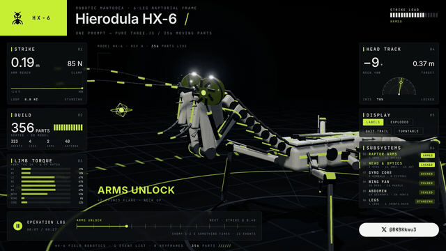

# teardown-forge

A Claude Code skill that turns any machine into a 3D simulator you can take apart, and records it as a 60 fps film with its own score.

Ask for a machine in one sentence. Claude builds it as one offline HTML page on a dark lime console: the machine runs in the middle, every panel around it reads the real numbers, a button opens the part doing the work, and when nobody touches it the page tours itself.



**Hierodula HX-6**, a robotic praying mantis with 356 moving parts: [watch the 27 s film (1080p60, with sound)](docs/mantis-hx6.mp4) · source in `sims/mantis-*`

| Telson SC-8 robotic scorpion | Pelagos OC-8 robotic octopus |
|---|---|
|  |  |

## Install

```
npx skills add bk19921030315-ai/teardown-forge -g -a claude-code
```

Then, once, in the installed folder:

```
npm install && npx playwright install chromium
```

You need Node.js 20 or newer. For the video you also need `ffmpeg`, and for the sound Python 3.

## Use

One line is enough; the house style (dark console, lime accent, panels, auto tour, film, score) is the default:

> Use teardown to build a robotic dragonfly with 300 moving parts.

> Teardown a hydraulic excavator arm and record the film.

> How does a mechanical watch keep time? Show me as a teardown.

Or open one of the 4 examples first:

```
node sims/build.mjs mantis-live      # Hierodula HX-6, a robotic mantis with 356 moving parts
node sims/build.mjs v8-live          # teardown-out/dist/v8-live.html
node sims/build.mjs cessna-live
node sims/build.mjs strandbeest-live
```

## What is inside

| | |
|---|---|
| `SKILL.md` | What Claude reads: the house style, how a machine is built, the rules that make it look right, the review loop. |
| `sims/kit/` | Runtime, stage, shader warm-up. |
| `sims/mantis-*`, `sims/v8-*`, `sims/cessna-*`, `sims/strandbeest-*` | 4 complete machines. `-shared` is the machine, `-live` the page you drive, `-film` the recorded tour. |
| `sims/build.mjs` | Bundles a machine into one HTML file, three.js and fonts inlined. |
| `sims/capture.mjs` | Renders the film frame by frame to a 60 fps mp4, or to review sheets of stills. |
| `sfx/`, `run_sfx.py` | Procedural sound on the film's timeline, mastered to −14 LUFS. |
| `docs/` | Preview GIFs and the HX-6 film. |

## Credits

Forked from [elvarofficial/teardown](https://github.com/elvarofficial/teardown) (MIT). Built on [whaleyxbt/claude-motion](https://github.com/whaleyxbt/claude-motion) (MIT): the runtime, frame capture, sound engine and review rules come from there. Recorded samples are CC0 from Freesound, prepared by [Barty-Bart/motion-graphics](https://github.com/Barty-Bart/motion-graphics); sources in `sfx/samples/SOURCES.md`.

MIT licence.
